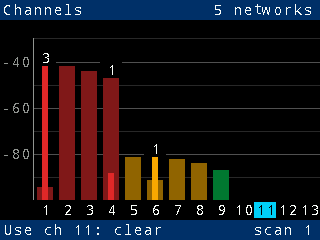
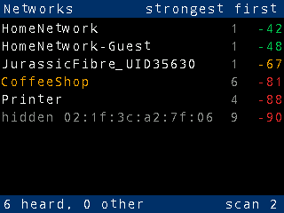
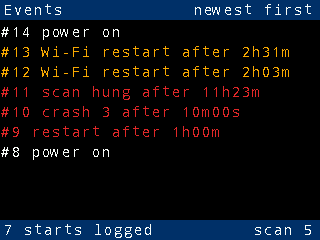
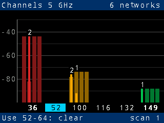
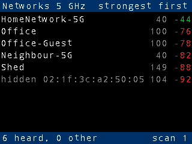

# Wi-Fi network meter

A [Zephyr RTOS](https://zephyrproject.org) firmware that works as a
Wi-Fi channel meter, for two targets: 2.4 GHz on both, and 5 GHz as well
on the XIAO ESP32-C5.

| Target | Hardware | Build | Guide |
|---|---|---|---|
| **Pico W** | Raspberry Pi Pico W with a Pimoroni Pico Display Pack 2.0 | `make pico` | [docs/targets/pico.md](docs/targets/pico.md) |
| **XIAO ESP32-C5** | Seeed XIAO ESP32-C5 with a 2.2" ILI9341 TFT, four buttons and an RGB LED (first runs on a breadboard) | `make xiao` | [docs/targets/xiao-esp32c5.md](docs/targets/xiao-esp32c5.md) |

Each target's guide has its hardware and pins, flashing, the serial
console, the battery, and its known issues. The screens, buttons and LED
are the same on both.

Every 10 seconds the meter scans for the Wi-Fi networks it can hear and
shows:

- **Channels**: for each 2.4 GHz channel (1-13), a bright bar for the
  strongest network on the channel (*signal*) inside a dim bar for every
  other network reaching it, on the same channel or spilling over from
  overlapping ones (*interference*), against a dBm scale with a grid line
  every 10 dB. Both are green, amber
  or red as the channel gets busier, judged on the combined signal of
  every network heard, weighted by how far each one's 20 MHz overlaps the
  channel. The number of networks on each channel is shown above its
  bars. The non-overlapping channels 1, 6 and 11 are labelled in bold,
  and the quietest of them is highlighted as the one to use.
- **Networks**: the strongest networks, with channel and signal strength
  (dBm, green, amber or red). Names of up to 24 characters show whole;
  longer ones are shortened in the middle, keeping the end. Open
  (unsecured) networks are shown in amber; hidden ones in grey, named by
  their MAC address (`hidden 02:1f:3c:a2:7f:06`).
- **Events**: each start of the meter, newest first, and why it started:
  power on, a Wi-Fi restart, a crash, a hung thread or an unexplained
  restart, with how long the run before it lasted. The log is kept in
  flash, so it survives power cuts and firmware updates.

| Channels | Networks | Events |
|---|---|---|
|  |  |  |

(Screenshots from `make test`, which draws the real screens on an in-memory
panel. The sample data is in `tests/ui_render`.)

Networks stay on screen after they were last heard: at full brightness for
60 s, then fading to 40% brightness, still readable, and gone at 2 minutes.
A scan that misses a network, or hears nothing at all, doesn't blank the
display; an empty or failed scan is
retried after 2 s.

**Buttons**: A next screen, B previous screen. On the Channels screen X
scans now; on the Networks and Events screens X and Y page up and down the
list when it is longer than the screen. On the Events screen, X and Y
pressed together print the whole log on the serial console.
**RGB LED** (dimmed by PWM to 2%): blue while scanning, then green, amber or
red for how busy the recommended channel is; magenta if a scan fails.
After 5 failed scans in a row it restarts itself, which recovers a Wi-Fi
driver that has stopped working (see below).

**Usage guide:** [docs/USAGE.md](docs/USAGE.md), and a printable one-page
[quick reference](docs/quick-reference.pdf) (from
`docs/quick-reference.html`).
**Serial console** on the board's USB socket (a USB serial port:
`/dev/cu.usbmodem<N>` on a Mac, `/dev/ttyACM<N>` on Linux): each scan's
per-channel figures as log lines. Open it with, for example,
`screen /dev/cu.usbmodem1101 115200` (quit with Ctrl-A then K).
`make pico BUILD_ARGS=-DCONFIG_METER_LOG_LEVEL_DBG=y` (or `make xiao ...`)
also logs every network each scan hears.

Scans are **passive** by default: the radio listens on each channel long
enough to hear every network's beacons, instead of sending probe requests
and moving on quickly, which misses weaker networks.
`-DCONFIG_METER_SCAN_PASSIVE=n` switches back to active scans.

**Keep it away from USB 3 hubs.** USB 3 hubs, ports and short cables give
off broadband noise across the 2.4 GHz band. Next to a hub, the meter
heard only a network at −41 dBm. On a 1 m cable, away from the hub, it
heard every network down to −92 dBm. If only strong networks show up,
move the meter away from USB 3 equipment, or power it from a USB charger.

**It restarts itself if the Wi-Fi driver gives up.** After 5 failed scans
in a row (`CONFIG_METER_RECOVER_AFTER`), the meter restarts, which takes a
few seconds. On the Pico W this recovers the Wi-Fi chip if it fails to
wake from its deep sleep, which it did every few hours; the meter now keeps
it out of that sleep (`CONFIG_METER_WIFI_KEEP_AWAKE`), so the restart is a
safety net
([docs/targets/pico.md](docs/targets/pico.md#known-issues-and-limits)).

**It logs every start in flash.** A 64 KB partition at the end of the
flash (`storage_partition`, in each board's overlay) holds a log of
starts, in Zephyr's flash circular buffer: one 20-byte record a start, the
oldest 4 KB erased when it fills, so it holds hundreds of starts and wears
the flash very slowly. Flashing new firmware leaves it alone, so the log
survives updates. Why each start happened comes from a note in RAM that
start-up doesn't clear (`app/src/reset_note.c`):

- Every restart the meter makes writes why in the note first: a Wi-Fi
  restart, a fatal error (Zephyr's fatal error handler is replaced, so a
  crash restarts the meter instead of halting it), or a thread the
  watchdog saw stop responding.
- A power cut loses RAM, so a start with no valid note is a power-on.
- A valid note with no reason means something restarted the meter without
  warning: the reset button, a debugger, or the hardware watchdog. The
  Pico W can't tell these apart; the XIAO ESP32-C5 records the chip's own
  reset cause and names it ("HW watchdog", "brown-out", ...).

The note also keeps how long the run has lasted, updated twice a second,
so the log says how long each run lasted before its restart. The events
screen shows the newest 64 starts; the console prints the newest 10 at
start-up. Pressing X and Y together on the events screen prints every start
in flash, oldest first, with its raw details (cause, run length in
seconds, error or crash reason, and the Wi-Fi failure count or crash
address), a line at a time as the console takes them; if nothing reads the
console for a second, the dump stops rather than freeze the screen.

**A watchdog restarts it if it hangs.** Zephyr's task watchdog gives the
main thread 5 s and the scan thread a scan and its wait plus 30 s to check
in; the chip's hardware watchdog (4 s) stands behind it in case the
kernel itself stops.

Everything is built in Docker, as in
[pi-zephyr-inet-radio](https://github.com/Rob-McKay/pi-zephyr-inet-radio), with
**Arm Toolchain for Embedded** (ATfE 23.1.0: Arm's clang/LLVM bare-metal
toolchain with picolibc) for the Pico W firmware and the host's clang for
the unit tests. The one exception is the XIAO ESP32-C5 firmware, built with
the Zephyr SDK's GCC because Espressif's SoC support doesn't build with
clang.

**5 GHz on the XIAO.** A Channels 5 GHz screen follows the 2.4 GHz one:
the channels in the 80 MHz blocks routers use (36-48 to 149-161), each
network counted across its whole block, as the meter can't tell how wide
a network is, and the quietest block recommended ("Use 52-64: clear").
A Networks 5 GHz list follows it, and the LED shows the band of the
screen last viewed. The 2.4 GHz screens are the same on both targets.

| Channels 5 GHz | Networks 5 GHz |
|---|---|
|  |  |

## Hardware

[hardware/](hardware/README.md) has a folder per target: for the Pico W a
3D-printable battery case with its wiring and parts, and for the XIAO
ESP32-C5 the wiring, power notes and parts. The pins are in each target's
guide.

## Build

Needs Docker (and `make`) on the host: Linux, macOS (Apple Silicon or
Intel) or Windows with WSL 2.

```sh
make image      # once: the build environment (a few minutes)
make pico       # the Pico W firmware: out/pico/network-meter.uf2
make xiao       # the XIAO ESP32-C5 firmware: out/xiao/network-meter.bin
make test       # checks, unit tests, and both firmware builds
```

`make shell` opens a shell in the build container.

**Wi-Fi country.** The regulatory domain decides which channels the chip
scans: channels 12 and 13 are allowed in the UK and Europe but not in
the US. The default is the UK. `WIFI_COUNTRY` changes it, in each
driver's own form:

```sh
make pico WIFI_COUNTRY=UNITED_STATES   # a WHD country name
make xiao WIFI_COUNTRY=US              # an ISO 3166 code
```

Other settings can be passed to CMake from `scripts/build.sh`, for example
`docker run ... scripts/build.sh pico -DCONFIG_METER_SCAN_INTERVAL_S=30`.
`app/Kconfig` lists them.

**Behind a TLS-intercepting proxy**, give the image build its CA
certificate: `make image EXTRA_CA=proxy-ca.crt`. `DOCKER_BUILD_FLAGS` passes
extra flags to `docker build`, such as `--network host` or
`--build-arg BASE_IMAGE=...` to pull Ubuntu from a mirror.

## Flash

- **Pico W**: hold BOOTSEL while plugging it in, and copy
  `out/pico/network-meter.uf2` to the `RPI-RP2` drive.
- **XIAO ESP32-C5**: from the host,
  `esptool --chip esp32c5 write-flash 0x2000 out/xiao/network-meter.bin`,
  or `out/xiao/network-meter-merged.bin` at 0 with a browser flasher.

Details, debugging and the console in each target's guide.

## How the figures are worked out

`app/src/core/chan_stats.c`, unit tested in `tests/meter_units`:

- Each scan's results are kept once per BSSID (access point), at the
  strongest signal reported. Networks the driver reports without a
  2.4 GHz channel are counted as "other". Hidden networks are counted
  like any other: carried Zephyr patches (`zephyr/patches.yml`) make both
  Wi-Fi drivers report their channel, signal and BSSID.
- 2.4 GHz channels are 5 MHz apart but 20 MHz wide. A network on channel
  *n* overlaps channel *n*±1 by 15 MHz, *n*±2 by 10 MHz and *n*±3 by 5 MHz.
  Channel 14 is 12 MHz above 13. A channel's **interference** is the sum of
  every network's signal power (in mW, not dBm), each scaled by its
  overlap ÷ 20 MHz, converted back to dBm. All of this is integer
  arithmetic, accurate to 1 dB.
- Levels: below −85 dBm is **clear** (green), −85 to −71 dBm **moderate**
  (amber), −70 dBm and above **busy** (red).
- The **recommended channel** is the one of 1, 6 and 11 with the least
  interference. On a tie it is the one with fewer networks, then the lower
  channel. It is the channel to move a router to, so it is usually one
  with little or nothing on it ("Use ch 1: clear").

## Repository layout

| Path | What |
|---|---|
| `hardware/pico/` | The Pico W's case (`case/case.py` generates `case/stl/`), wiring diagram and bill of materials |
| `hardware/xiao-esp32c5/` | The XIAO ESP32-C5's wiring, power notes and bill of materials; Seeed's board documents in `vendor/` |
| `docs/targets/` | Each target's guide: hardware, pins, flashing, console, battery, known issues |
| `app/src/main.c` | Redraw loop, buttons, LED |
| `app/src/scan_task.c` | Scan thread: scans on a schedule into the history; console report |
| `app/src/scanner.c` | Wi-Fi scans through Zephyr's `net_mgmt` Wi-Fi API |
| `app/src/core/chan_stats.c` | Channel statistics (no Zephyr dependencies) |
| `app/src/core/ap_history.c` | Networks heard over recent scans, with their age and fade (no Zephyr dependencies) |
| `app/src/core/scan_health.c` | Counts failed scans in a row, to restart when the Wi-Fi driver gives up (no Zephyr dependencies) |
| `app/src/core/paging.c` | Paging through the network and event lists a screenful at a time (no Zephyr dependencies) |
| `app/src/core/boot_record.c` | Records of starts and the restart note: format, checksum, descriptions (no Zephyr dependencies) |
| `app/src/event_log.c` | The log of starts in flash (FCB in `storage_partition`) |
| `app/src/reset_note.c` | The restart note in RAM; every restart, and the fatal error handler |
| `app/src/watchdog.c` | Task watchdog per thread, with the hardware watchdog behind it |
| `app/src/ui.c`, `gfx.c`, `core/text_raster.c` | The screens; drawing straight to the panel through a one-line band buffer (no frame buffer); text in Zephyr's CFB fonts |
| `app/src/controls.c`, `status_led.c` | Buttons (input subsystem, `gpio-keys`); RGB LED (LED API, `pwm-leds`) and backlight (`gpio-leds`) |
| `app/src/core/country_code.c` | Wi-Fi country codes: what `CONFIG_METER_WIFI_COUNTRY` may be (no Zephyr dependencies) |
| `app/src/wifi_country.c` | Sets the Wi-Fi country through Zephyr's regulatory-domain request, for drivers that take it (`CONFIG_METER_WIFI_COUNTRY`; not the Pico W's) |
| `app/src/reset_cause.c` | The hardware's reset cause, kept in each start's record (`CONFIG_METER_RESET_CAUSE_HWINFO`; not the Pico W's) |
| `app/src/core/` | The hardware-independent core: the files above marked "no Zephyr dependencies" (no device APIs), built into the firmware and every test suite from one list, `cmake/meter_core.cmake` |
| `app/src/core/keys.c` | X and Y pressed together, from key presses and releases (no Zephyr dependencies) |
| `app/boards/rpi_pico_rp2040_w.overlay`, `.conf` | The Pico W's own parts, which Zephyr adds by board name: the Display Pack 2.0 devicetree, the console on the USB port, the CYW43439's country |
| `app/boards/xiao_esp32c5_esp32c5_hpcore.overlay`, `.conf` | The XIAO ESP32-C5's own parts: the TFT, buttons and RGB LED devicetree, a 64 KB event log partition, flash size, Wi-Fi country, scan dwell time, reset cause |
| `app/src/target/pico/usb_console.c` | Flow control for the console on the Pico's USB port, while a terminal has it open (`CONFIG_METER_USB_CONSOLE_FLOW`) |
| `app/src/target/pico/wifi_awake.c` | Keeps the Pico W's Wi-Fi chip out of its deep sleep, which it sometimes failed to wake from (`CONFIG_METER_WIFI_KEEP_AWAKE`; needs the carried hal_infineon patch) |
| `tests/meter_units` | Unit tests: channel statistics, network history and fading, text rendering (native_sim, AddressSanitizer) |
| `tests/ui_render` | The screens drawn on a fake 320x240 panel: pixel checks and screenshots |
| `cmake/toolchain.cmake` | Compiler choice: ATfE for the Pico, host clang for native_sim, the Zephyr SDK's GCC for the XIAO ESP32-C5 |
| `cmake/strict.cmake`, `.clang-tidy` | Warnings as errors and clang-tidy on every file ([docs/CODING.md](docs/CODING.md)) |
| `west.yml` | Zephyr pin, the same commit as the radio project (v4.5.0-rc2), and only the modules needed |
| `zephyr/patches.yml` | Zephyr patches carried until merged upstream (below) |
| `Dockerfile`, `Makefile`, `scripts/` | Build environment and wrappers |

## Zephyr patches carried

`zephyr/patches.yml` lists each with its reason. In short:

`zephyr/patches/zephyr/rpi-pico-boot2-clang-target.patch` (Pico W): the RP2040's
second-stage bootloader is built as a separate CMake project that is only
told the compiler's path. A GCC cross compiler implies its target. clang
instead assembles for the host and fails ("unknown CPU name cortex-m0plus").
The patch passes the LLVM toolchain's target triple on as well. It is
applied by `west patch apply` when the image is built, and is not yet sent
upstream. The built image's boot block has a valid CRC and UF2 family ID
(RP2040).

`airoc-hidden-network-results.patch` (Pico W): the AIROC driver reports a
hidden network's channel, signal and BSSID, not just a named network's.

`esp32-wifi-scan-params.patch` (XIAO ESP32-C5): the ESP32 driver reports
hidden networks and passes the scan's dwell times and bands on to
Espressif's library, which it otherwise ignores.

## Status

The firmware for both targets and the tests build and pass in the Docker
image, and the UI is checked by `tests/ui_render`. The XIAO ESP32-C5 runs
on a breadboard: it scans, shows the screens and takes all four buttons.
Its guide lists what has and hasn't been checked on hardware yet.

## Licence

Apache License 2.0, the same licence as Zephyr: see [LICENSE](LICENSE), the
licence text as published by the Apache Software Foundation
(https://www.apache.org/licenses/LICENSE-2.0.txt). Every source file
carries `SPDX-License-Identifier: Apache-2.0`.

Third-party parts keep their own licences: Zephyr and its modules (Apache
2.0), and the Infineon CYW43439 Wi-Fi firmware and CLM blob that the Docker
image fetches with `west blobs` (Infineon's licence, in hal_infineon's
`zephyr/blobs/license.txt`), and Espressif's Wi-Fi, PHY and coexistence
libraries for the ESP32-C5, also fetched with `west blobs` (Apache 2.0, in
hal_espressif's `zephyr/blobs/license.txt`), which are built into the
firmware images. Seeed's XIAO ESP32-C5
schematic, KiCad project and pinout sheet in
`hardware/xiao-esp32c5/vendor/` are © Seeed Studio, under CC BY-SA 4.0
(the pinout sheet states no licence of its own); see that folder's
README.
