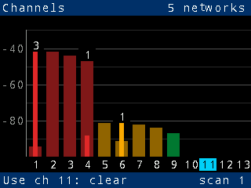
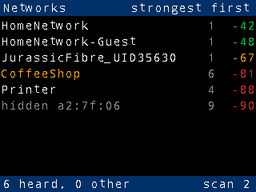

# Pico W network meter

A [Zephyr RTOS](https://zephyrproject.org) firmware for a **Raspberry Pi Pico W**
with a **Pimoroni Pico Display Pack 2.0** that works as a 2.4 GHz Wi-Fi
channel meter. Every 10 seconds it scans for the Wi-Fi networks it can hear
and shows:

- **Channels**: for each 2.4 GHz channel (1-13), a bright bar for the
  strongest network on the channel (*signal*) inside a dim bar for the
  spill-over from networks on overlapping channels (*interference*),
  against a dBm scale with a grid line every 10 dB. Both are green, amber
  or red as the channel gets busier, judged on the combined signal of
  every network heard, weighted by how far each one's 20 MHz overlaps the
  channel. The number of networks on each channel is shown above its
  bars. The quietest of the non-overlapping channels 1, 6 and 11 is
  highlighted as the one to use.
- **Networks**: the strongest networks, with channel, signal strength (dBm)
  and a signal bar. Open (unsecured) networks are shown in amber.

| Channels | Networks |
|---|---|
|  |  |

(Screenshots from `make test`, which draws the real screens on an in-memory
panel. The sample data is in `tests/ui_render`.)

Networks stay on screen after they were last heard: at full brightness for
15 s, then fading to black by 30 s. A scan that misses a network, or hears
nothing at all, doesn't blank the display; an empty or failed scan is
retried after 2 s.

**Buttons**: A next screen, B previous screen, X scan now.
**RGB LED** (dimmed by PWM to 5%): blue while scanning, then green, amber or
red for how busy the recommended channel is; magenta if a scan fails.
After 5 failed scans in a row it restarts itself, which recovers a Wi-Fi
driver that has stopped working (see below).

**Usage guide:** [docs/USAGE.md](docs/USAGE.md), and a printable one-page
[quick reference](docs/quick-reference.pdf) (from
`docs/quick-reference.html`).
**Serial console** on the Pico's own USB socket (a USB serial port:
`/dev/cu.usbmodem<N>` on a Mac, `/dev/ttyACM<N>` on Linux): each scan's
per-channel figures as log lines. Open it with, for example,
`screen /dev/cu.usbmodem1101 115200` (any baud rate works; quit with Ctrl-A
then K). `make pico BUILD_ARGS=-DCONFIG_METER_LOG_LEVEL_DBG=y` also logs
every network each scan hears.

Scans are **passive** by default: the radio listens on each channel long
enough to hear every network's beacons, instead of sending probe requests
and moving on quickly, which misses weaker networks.
`-DCONFIG_METER_SCAN_PASSIVE=n` switches back to active scans.

**Keep it away from USB 3 hubs.** USB 3 hubs, ports and short cables give
off broadband noise across the 2.4 GHz band. Next to a hub, the meter
heard only a network at −41 dBm. On a 1 m cable, away from the hub, it
heard every network down to −92 dBm. If only strong networks show up,
move the meter away from USB 3 equipment, or power it from a USB charger.
The Display Pack also sits over the Pico W's antenna (the end opposite the
USB socket), which costs a little range.

**It restarts itself if the Wi-Fi driver gives up.** After about 12 hours
of scans, the AIROC Wi-Fi driver ran out of packet buffers for good (the
console showed `failed to allocate a packet buffer for IOVAR` and
`Failed to start scan` every 2 seconds). They leak somewhere in the
driver or its WHD library, and only a restart gets them back. So after 5
failed scans in a row (`CONFIG_METER_RECOVER_AFTER`), the meter restarts,
which takes a few seconds.

Everything is built in Docker, as in
[pi-zephyr-inet-radio](https://github.com/Rob-McKay/pi-zephyr-inet-radio), with
**Arm Toolchain for Embedded** (ATfE 23.1.0: Arm's clang/LLVM bare-metal
toolchain with picolibc) for the firmware and the host's clang for the unit
tests. There is no GCC anywhere.

## Hardware

- Raspberry Pi Pico W (RP2040 + Infineon CYW43439 Wi-Fi). The CYW43439 is a
  2.4 GHz-only chip, so the meter covers the 2.4 GHz band.
- [Pimoroni Pico Display Pack 2.0](https://shop.pimoroni.com/products/pico-display-pack-2-0)
  plugged onto the Pico's headers: 320x240 IPS panel (ST7789V), four
  buttons and an RGB LED.

| Display Pack function | Pico W GPIO |
|---|---|
| LCD CS / SCLK / MOSI (SPI0) | 17 / 18 / 19 |
| LCD DC | 16 |
| Backlight | 20 |
| Buttons A / B / X / Y | 12 / 13 / 14 / 15 |
| LED red / green / blue | 6 / 7 / 8 |

None of these clash with the CYW43439's pins (23, 24, 25, 29). The
devicetree overlay is `app/boards/rpi_pico_rp2040_w.overlay`. If the picture is
upside down on your unit, change the panel's `mdac` there from `0x60` to `0xa0`.

## Build

Needs Docker (and `make`) on the host: Linux, macOS (Apple Silicon or
Intel) or Windows with WSL 2.

```sh
make image      # once: the build environment (a few minutes)
make pico       # the firmware: out/pico/network-meter.uf2
make test       # unit tests and the documentation check
```

`make shell` opens a shell in the build container.

**Wi-Fi country.** The regulatory domain decides which channels the chip
scans: channels 12 and 13 are allowed in the UK and Europe but not in
the US. The default is the UK. To change it, pass a country name from
Infineon's WHD (`whd_country_code_t` in `whd_types.h`) without its
`WHD_COUNTRY_` prefix:

```sh
make pico WIFI_COUNTRY=UNITED_STATES
```

Other settings can be passed to CMake from `scripts/build.sh`, for example
`docker run ... scripts/build.sh pico -DCONFIG_METER_SCAN_INTERVAL_S=30`.
`app/Kconfig` lists them.

**Behind a TLS-intercepting proxy**, give the image build its CA
certificate: `make image EXTRA_CA=proxy-ca.crt`. `DOCKER_BUILD_FLAGS` passes
extra flags to `docker build`, such as `--network host` or
`--build-arg BASE_IMAGE=...` to pull Ubuntu from a mirror.

## Flash

1. Hold the Pico W's **BOOTSEL** button while plugging it into USB. It
   appears as a drive called `RPI-RP2`.
2. Copy `out/pico/network-meter.uf2` to that drive. The Pico restarts into
   the meter.

For SWD (a Raspberry Pi Debug Probe), `out/pico/network-meter.elf` works with
OpenOCD or probe-rs. `west flash` also works from a host with a west workspace.

## How the figures are worked out

`app/src/chan_stats.c`, unit tested in `tests/meter_units`:

- Each scan's results are kept once per BSSID (access point), at the
  strongest signal reported. Networks the driver reports without a
  2.4 GHz channel are counted as "other". The CYW43439 driver reports
  hidden networks that way.
- 2.4 GHz channels are 5 MHz apart but 20 MHz wide. A network on channel
  *n* overlaps channel *n*±1 by 15 MHz, *n*±2 by 10 MHz and *n*±3 by 5 MHz.
  Channel 14 is 12 MHz above 13. A channel's **interference** is the sum of
  every network's signal power (in mW, not dBm), each scaled by its
  overlap ÷ 20 MHz, converted back to dBm. All of this is integer
  arithmetic, accurate to 1 dB.
- Levels: below −85 dBm is **clear** (green), −85 to −71 dBm **moderate**
  (amber), −70 dBm and above **busy** (red).
- The **recommended channel** is the one of 1, 6 and 11 with the least
  interference. On a tie it is the one with fewer networks, then the lower
  channel. It is the channel to move a router to, so it is usually one
  with little or nothing on it ("Use ch 1: clear").

## Repository layout

| Path | What |
|---|---|
| `app/src/main.c` | Redraw loop, buttons, LED |
| `app/src/scan_task.c` | Scan thread: scans on a schedule into the history; console report |
| `app/src/scanner.c` | Wi-Fi scans through Zephyr's `net_mgmt` Wi-Fi API |
| `app/src/chan_stats.c` | Channel statistics (no Zephyr dependencies) |
| `app/src/ap_history.c` | Networks heard over recent scans, with their age and fade (no Zephyr dependencies) |
| `app/src/ui.c`, `gfx.c`, `text_raster.c` | The screens; drawing straight to the panel through a one-line band buffer (no frame buffer); text in Zephyr's CFB fonts |
| `app/src/controls.c`, `status_led.c` | Buttons (input subsystem, `gpio-keys`); RGB LED (LED API, `pwm-leds`) and backlight (`gpio-leds`) |
| `app/boards/rpi_pico_rp2040_w.overlay` | Display Pack 2.0 devicetree |
| `tests/meter_units` | Unit tests: channel statistics, network history and fading, text rendering (native_sim, AddressSanitizer) |
| `tests/ui_render` | The screens drawn on a fake 320x240 panel: pixel checks and screenshots |
| `cmake/toolchain.cmake` | Compiler choice: ATfE for the Pico, host clang for native_sim |
| `cmake/strict.cmake`, `.clang-tidy` | Warnings as errors and clang-tidy on every file ([docs/CODING.md](docs/CODING.md)) |
| `west.yml` | Zephyr pin, the same commit as the radio project (v4.5.0-rc2), and only the modules needed |
| `zephyr/patches.yml` | Zephyr patches carried until merged upstream (below) |
| `Dockerfile`, `Makefile`, `scripts/` | Build environment and wrappers |

## Zephyr patch carried

`zephyr/patches/zephyr/rpi-pico-boot2-clang-target.patch`: the RP2040's
second-stage bootloader is built as a separate CMake project that is only
told the compiler's path. A GCC cross compiler implies its target. clang
instead assembles for the host and fails ("unknown CPU name cortex-m0plus").
The patch passes the LLVM toolchain's target triple on as well. It is
applied by `west patch apply` when the image is built, and is not yet sent
upstream. The built image's boot block has a valid CRC and UF2 family ID
(RP2040).

## Status

The firmware and the tests build and pass in the Docker image. The UI is
checked by `tests/ui_render`. It has **not yet been run on a real Pico W and
Display Pack**. Things to check first on hardware:

- Panel orientation and colours (`mdac`, `inversion-off` in the overlay).
- The 62.5 MHz SPI clock to the panel (`mipi-max-frequency`). Lower it if
  the picture is garbled.
- Scan times. The scan timeout is `CONFIG_METER_SCAN_TIMEOUT_S` (default
  15 s); a scan that runs over it is shown with what it heard.

## Licence

Apache License 2.0, the same licence as Zephyr: see [LICENSE](LICENSE), the
licence text as published by the Apache Software Foundation
(https://www.apache.org/licenses/LICENSE-2.0.txt). Every source file
carries `SPDX-License-Identifier: Apache-2.0`.

Third-party parts keep their own licences: Zephyr and its modules (Apache
2.0), and the Infineon CYW43439 Wi-Fi firmware and CLM blob that the Docker
image fetches with `west blobs` (Infineon's licence, in hal_infineon's
`zephyr/blobs/license.txt`), which are built into the firmware image.
