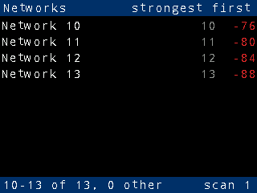
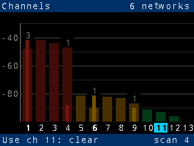

# Using the network meter

The meter listens for 2.4 GHz Wi-Fi networks and shows how crowded each
channel is, so you can pick the best channel for your own router. A
printable one-page version of this guide is in
[quick-reference.pdf](quick-reference.pdf).

## Starting up

Plug the Pico W into any USB power supply. The screen shows
**Scanning...** and the LED turns blue. The first results appear a few
seconds later. After that the meter scans again every 10 seconds on its
own.

## Buttons

The four buttons are beside the screen, two on each side.

| Button | What it does |
|---|---|
| **A** | Next screen |
| **B** | Previous screen |
| **X** | Channels screen: scan now, without waiting for the next scan. Networks screen: previous page |
| **Y** | Networks screen: next page |

## Screens

### Channels

- **Two bars per channel**, 1 to 13, one inside the other:
  - **Bright, narrow bar: signal.** The strongest network on that
    channel. No bright bar means no network uses the channel.
  - **Dim, wide bar: interference.** Every other network the channel
    hears: other networks on the same channel, and those on nearby
    channels spilling over (a 2.4 GHz network overlaps its neighbours up
    to 3 channels away). A channel with one network and nothing nearby
    has no dim bar.
- **The scale** on the left is in dBm, the signal reaching the channel,
  with a grid line every 10 dB; the labelled lines are brighter.
- **Bar colour** shows how busy the channel is, counting both:
  green = clear, amber = moderate, red = busy.
- **The number above a bar** is how many networks use that channel.
- **Bold channel numbers** are the standard channels 1, 6 and 11. Those
  three are the only channels that don't overlap each other, so routers
  should use one of them.
- **The highlighted channel number** is the recommended channel: the
  quietest of 1, 6 and 11.
- **Footer:** "Use ch 6: clear" names the recommended channel and how busy
  it is. "Nothing heard" means no networks are showing. The scan count is
  on the right.
- **Header:** how many networks are showing.

### Networks

The strongest networks, one per row:

- **Name.** Shown in amber if the network is open (no password), white
  if it is secured. A hidden network, which doesn't broadcast its name, is
  shown in grey as "hidden" and the last three bytes of its MAC address
  (BSSID), such as `hidden a2:7f:06`, which tell its access points apart.
  Names up to 24 characters, such as `JurassicFibre_UID35630`, are shown
  whole; longer ones are shortened in the middle with `..`, keeping the
  start and the end, which often tells similar names apart.
- **Channel.**
- **Signal strength** in dBm. Closer to 0 is stronger: −40 is very strong,
  −90 is barely there. Its colour: green = good (−60 dBm or better),
  amber = fair (down to −75 dBm), red = weak.

The screen has room for 9 networks. When more are heard, **Y** pages down
the list and **X** back up, and the footer shows which are on screen,
such as "10-13 of 13".

The footer gives how many networks are showing ("heard"), and how many
results were ignored ("other"): those not on a 2.4 GHz channel, or past
the 64 the meter keeps. Each access point counts once, so a router with a
guest network counts twice.

## Fading

A network stays on screen after it was last heard, so one scan that misses
it doesn't make it vanish:

- For **15 seconds** after it was last heard it is shown at full
  brightness.
- It then **fades**, and has faded to **black at 30 seconds**, when it is
  removed.
- If it is heard again, it is back at full brightness straight away.

So dim bars and rows are old data. If the whole screen fades, the meter has
heard nothing for a while.

## LED

The RGB LED is on the right of the screen.

| LED | Meaning |
|---|---|
| **Blue** | Scanning |
| **Green** | The recommended channel is clear |
| **Amber** | The recommended channel is moderately busy |
| **Red** | Even the recommended channel is busy |
| **Magenta** | The last scan failed; it is retried after 2 seconds. After 5 failures in a row the meter restarts itself |
| Off | Starting up |

## Tips

- **Choosing a channel:** set your router to the channel the meter
  recommends. Check it from where you actually use Wi-Fi, not right next
  to the router.
- **Walk around:** the readings change from room to room. Press **X** on
  the Channels screen for an immediate scan after moving.
- **Only 2.4 GHz:** the Pico W's radio cannot hear 5 GHz networks.
- **Keep away from USB 3 hubs:** they give off noise across the 2.4 GHz
  band that drowns out all but the strongest networks. Use a long cable or
  a USB charger, away from computers and hubs. If only your own router
  shows up, this is the likely cause.
- **Serial console:** the Pico's USB socket is also a serial port. On a Mac
  it appears as `/dev/cu.usbmodem<N>` (`ls /dev/cu.usbmodem*` finds it):
  open it with `screen /dev/cu.usbmodem<N> 115200`, and quit with Ctrl-A
  then K. On Linux it is `/dev/ttyACM<N>`. Each scan's per-channel figures
  are printed there. Logging starts when the port is opened, so the first
  moments after power-up are not shown.

## Settings

Change these when building the firmware: `make pico` with
`WIFI_COUNTRY=...`, or `-DCONFIG_...=` options passed to
`scripts/build.sh` (see the README).

| Setting | Default | |
|---|---|---|
| `WIFI_COUNTRY` | `UNITED_KINGDOM` | Which channels may be scanned (the US stops at 11) |
| `CONFIG_METER_SCAN_INTERVAL_S` | 10 | Seconds between scans |
| `CONFIG_METER_RECOVER_AFTER` | 5 | Failed scans in a row before the meter restarts itself (0: never) |
| `CONFIG_METER_FADE_START_S` | 15 | Seconds at full brightness |
| `CONFIG_METER_FADE_END_S` | 30 | Seconds until faded out |
| `CONFIG_METER_LED_BRIGHTNESS` | 2 | LED brightness, percent (1 is the dimmest) |
