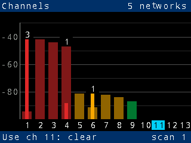
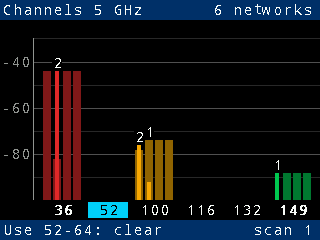
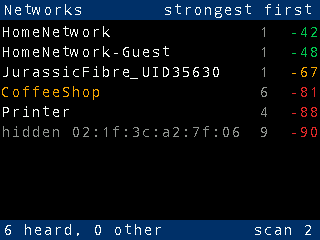
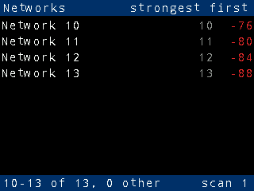
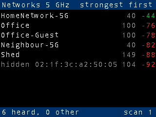
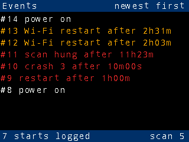
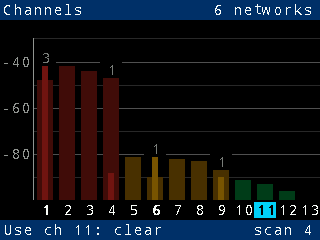

# Using the network meter

The meter listens for Wi-Fi networks and shows how crowded each channel
is, so you can pick the best channel for your own router: 2.4 GHz on both
targets, and 5 GHz as well on the XIAO ESP32-C5. A
printable one-page version of this guide is in
[quick-reference.pdf](quick-reference.pdf).

It works the same on both of the meter's targets, the Raspberry Pi Pico W
with a Pico Display Pack 2.0 and the Seeed XIAO ESP32-C5 with a 2.2" TFT.
What differs between them, such as flashing and the battery, is in
[Pico W and XIAO ESP32-C5](#pico-w-and-xiao-esp32-c5) below.

## Starting up

Plug the meter into any USB power supply, or switch on its battery. The
screen shows **Scanning...** and the LED turns blue. The first results
appear a few seconds later. After that the meter scans again every 10
seconds on its own.

## Buttons

There are four buttons, A, B, X and Y. On the Pico W's Display Pack they
are beside the screen, A and B on the left, X and Y on the right.

| Button | What it does |
|---|---|
| **A** | Next screen: Channels, Networks, then on the XIAO Channels 5 GHz and Networks 5 GHz, then Events |
| **B** | Previous screen |
| **X** | Channels screens: scan now, without waiting for the next scan. Networks and Events screens: previous page |
| **Y** | Networks and Events screens: next page |
| **X** and **Y** together | Events screen: print the whole log on the serial console |

## Screens

### Channels



- **Two bars per channel**, 1 to 13, one inside the other:
  - **Bright, narrow bar: signal.** The strongest network on that
    channel. No bright bar means no network uses the channel.
  - **Dim, wide bar: interference.** Every other network the channel
    hears: other networks on the same channel, and those on nearby
    channels spilling over (a 2.4 GHz network overlaps its neighbours up
    to 3 channels away). A channel with one network and nothing nearby
    has no dim bar.
- **The scale** on the left is in dBm, the signal reaching the channel,
  with a grid line every 10 dB; the labelled lines are brighter.
- **Bar colour** shows how busy the channel is, counting both:
  green = clear, amber = moderate, red = busy.
- **The number above a bar** is how many networks use that channel.
- **Bold channel numbers** are the standard channels 1, 6 and 11. Those
  three are the only channels that don't overlap each other, so routers
  should use one of them.
- **The highlighted channel number** is the recommended channel: the
  quietest of 1, 6 and 11.
- **Footer:** "Use ch 6: clear" names the recommended channel and how busy
  it is. "Nothing heard" means no networks are showing. The scan count is
  on the right.
- **Header:** how many networks are showing.

### Channels 5 GHz (XIAO ESP32-C5)



The same idea for 5 GHz, after the 2.4 GHz Channels and Networks screens. 5 GHz channels don't
overlap each other the way 2.4 GHz ones do; instead a router joins
neighbouring channels into one wider channel. Most home routers use
**80 MHz**, four channels, so the chart groups the channels in fours:

- **Four columns to a block**, 36-48, 52-64, 100-112, 116-128, 132-144
  and 149-161, labelled by the block's first channel, with a gap between
  blocks.
- **Bright bar:** the strongest network whose main channel is this one.
  **Dim bars:** every other network in the block. The meter can't tell how
  wide a network is, so it counts every 5 GHz network across its whole
  80 MHz block: a block with one network on it lights up all four columns.
- **The number above a bar:** networks on that channel ("+" for 10 or
  more).
- **Bold labels** are the blocks without DFS (36 and 149). On the others,
  a router must first listen for radar for a minute before it can use the
  channel, and may have to move if it hears some.
- **The highlighted label** is the recommended block, the quietest the
  meter is set to consider (36-48 to 116-128; see
  [Settings](#settings)). On a tie it prefers fewer networks, then a block
  without DFS, then the lower block.
- **Footer:** "Use 52-64: clear": the block to set your router's 5 GHz
  channel to (any channel of it, at 80 MHz), and how busy it is.

Channels 165-177 aren't charted, but their networks are counted and
listed.

### Networks



The strongest networks, one per row:

- **Name.** Shown in amber if the network is open (no password), white
  if it is secured. A hidden network, which doesn't broadcast its name, is
  shown in grey as "hidden" and its MAC address (BSSID), such as
  `hidden 02:1f:3c:a2:7f:06`, which tells its access points apart. The
  first three bytes identify the maker: look them up in the IEEE's
  register of MAC prefixes (OUI).
  Names up to 24 characters, such as `JurassicFibre_UID35630`, are shown
  whole; longer ones are shortened in the middle with `..`, keeping the
  start and the end, which often tells similar names apart.
- **Channel.**
- **Signal strength** in dBm. Closer to 0 is stronger: −40 is very strong,
  −90 is barely there. Its colour: green = good (−60 dBm or better),
  amber = fair (down to −75 dBm), red = weak.

The screen has room for 9 networks. When more are heard, **Y** pages down
the list and **X** back up, and the footer shows which are on screen,
such as "10-13 of 13".



**One band at a time.** The Networks screen lists the 2.4 GHz networks.
On the XIAO, a second list, **Networks 5 GHz**, follows the Channels
5 GHz screen and lists only the 5 GHz networks.



The footer gives how many networks are showing ("heard"), and how many
results were ignored ("other"): those on no channel the meter knows (on
the Pico W, any 5 GHz network that reaches it), or past the 64 the meter
keeps. Each access point counts once, so a router with a guest network
counts twice.

### Events



Each time the meter started, newest first, numbered, and why. Where it
restarted itself, how long it had been running before:

| Event | Colour | Meaning |
|---|---|---|
| **power on** | white | Power was applied, or came back after a cut |
| **Wi-Fi restart after …** | amber | The Wi-Fi driver stopped working, so the meter restarted itself (after 5 failed scans in a row) |
| **crash N after …** | red | A fatal error (number N): the meter restarted itself |
| **scan hung / main hung after …** | red | A part of the meter stopped responding, and the watchdog restarted it |
| **restart after …** | red | Restarted with no reason recorded: the reset button, a debugger, or a dip in the supply |

A restart with no reason recorded says what the chip saw instead, where it
tells more than "restart". The Pico W can say only whether its hardware
watchdog did it; the XIAO ESP32-C5 records the chip's own reset cause, so
it can name the others too:

| Event | Colour | Meaning |
|---|---|---|
| **brown-out** | white | The supply dropped too low (a flat battery or a weak USB supply), then came back: shown in place of "power on" (XIAO) |
| **HW watchdog after …** | red | The chip's hardware watchdog restarted it: the whole system stopped, not just one part of the meter (both boards) |
| **CPU fault after …** | red | The processor faulted in a way the meter couldn't record as a crash (XIAO) |
| **reset button after …** | red | The chip's reset pin (XIAO). The XIAO's own reset button resets the whole chip, which it reports as a power-on instead |

On the console's full listing (below), such a start ends with `hw` and the
cause's number: 1 power-on, 2 reset pin, 3 software, 4 watchdog,
5 brown-out, 6 CPU fault, 7 wake-up, 8 other.

The log is kept in flash, so it survives power cuts and firmware updates.
The screen shows the newest 64 (9 to a page: **Y** next page, **X**
previous). The serial console prints the newest 10 when the meter starts.

To see the whole log with every detail, open the serial console (see
[Tips](#tips)) and press **X** and **Y** together on the Events screen. It
prints every start kept in flash, oldest first, such as:

```
#13 Wi-Fi restart after 2h31m: cause 2, ran 9060 s, detail -11, arg 0x00000005
```

where *detail* is the error (Wi-Fi), the reason (crash) or which part hung
(watchdog: 0 main, 1 scan), and *arg* is how many scans failed in a row
(Wi-Fi) or the program address of the crash. The footer says when it has
been sent. Press X first and it pages up a moment before; that does no
harm.

## Fading



A network stays on screen after it was last heard, so one scan that misses
it doesn't make it vanish:

- For **60 seconds** after it was last heard it is shown at full
  brightness. Weak and hidden networks are often missed by a scan or two,
  so this keeps them on screen.
- It then **fades**, down to 40% brightness so it stays readable, and at
  **2 minutes** it is removed.
- If it is heard again, it is back at full brightness straight away.

So dim bars and rows are old data. If the whole screen fades, the meter has
heard nothing for a while.

## LED

The RGB LED is to the right of the screen on the Pico W's Display Pack.

| LED | Meaning |
|---|---|
| **Blue** | Scanning |
| **Green** | The recommended channel is clear |
| **Amber** | The recommended channel is moderately busy |
| **Red** | Even the recommended channel is busy |
| **Magenta** | The last scan failed; it is retried after 2 seconds. After 5 failures in a row the meter restarts itself |
| Off | Starting up |

On the XIAO, the LED follows the band of the screen you last looked at:
on Channels 5 GHz and Networks 5 GHz (and on Events after them) it shows
how busy the recommended 5 GHz block is.

## Tips

- **Choosing a channel:** set your router to the channel the meter
  recommends. Check it from where you actually use Wi-Fi, not right next
  to the router.
- **Walk around:** the readings change from room to room. Press **X** on
  the Channels screen for an immediate scan after moving.
- **Only 2.4 GHz on the Pico W:** its radio cannot hear 5 GHz networks.
  The XIAO hears both bands.
- **Keep away from USB 3 hubs:** they give off noise across the 2.4 GHz
  band that drowns out all but the strongest networks. Use a long cable or
  a USB charger, away from computers and hubs. If only your own router
  shows up, this is the likely cause.
- **Serial console:** the board's USB socket is also a serial port. On a
  Mac it appears as `/dev/cu.usbmodem<N>` (`ls /dev/cu.usbmodem*` finds
  it): open it with `screen /dev/cu.usbmodem<N> 115200`, and quit with
  Ctrl-A then K. On Linux it is `/dev/ttyACM<N>`. Each scan's per-channel
  figures are printed there. On the Pico W, logging starts when the port
  is opened, so the first moments after power-up are not shown.

## Settings

Change these when building the firmware: `make pico` or `make xiao` with
`WIFI_COUNTRY=...`, or `-DCONFIG_...=` options passed to
`scripts/build.sh` (see the README).

| Setting | Default | |
|---|---|---|
| `WIFI_COUNTRY` | `UNITED_KINGDOM` (Pico W), `GB` (XIAO) | Which channels may be scanned (the US stops at 11): a WHD country name on the Pico W, an ISO 3166 code on the XIAO |
| `CONFIG_METER_SCAN_INTERVAL_S` | 10 | Seconds between scans |
| `CONFIG_METER_RECOVER_AFTER` | 5 | Failed scans in a row before the meter restarts itself (0: never) |
| `CONFIG_METER_FADE_START_S` | 60 | Seconds at full brightness |
| `CONFIG_METER_FADE_END_S` | 120 | Seconds until a network is removed |
| `CONFIG_METER_FADE_MIN_PERCENT` | 40 | Brightness a network fades to before it is removed (0: fade to black) |
| `CONFIG_METER_LED_BRIGHTNESS` | 2 | LED brightness, percent (1 is the dimmest) |
| `CONFIG_METER_RECOMMEND_5G_132` | off | XIAO: also recommend the 5 GHz block 132-144 (allowed in the US; not at 80 MHz in Europe and the UK) |
| `CONFIG_METER_RECOMMEND_5G_UPPER` | off | XIAO: also recommend 149-161 (full power in the US; low-power and indoor only in the UK) |

## Pico W and XIAO ESP32-C5

The screens, buttons and LED are the same on both. These differ; each
target's guide ([Pico W](targets/pico.md),
[XIAO ESP32-C5](targets/xiao-esp32c5.md)) has the details.

| | Pico W with Display Pack 2.0 | XIAO ESP32-C5 with 2.2" TFT |
|---|---|---|
| **Flashing** | Hold BOOTSEL while plugging it in, copy `network-meter.uf2` to the `RPI-RP2` drive | `esptool --chip esp32c5 write-flash 0x2000 network-meter.bin` over USB-C (hold BOOT while plugging in if it won't connect), or the merged image with a browser flasher |
| **Battery** | A separate charger (LiPo Amigo Pro) in the printed case; its USB-C socket charges and powers the meter | The XIAO charges a LiPo on its BAT pads from its own USB-C socket, and runs from it when unplugged |
| **Console** | The Pico's USB socket (inside the case) | The XIAO's USB-C socket |
| **Bands** | 2.4 GHz only | 2.4 and 5 GHz: Channels 5 GHz and Networks 5 GHz screens, and the LED follows the band of the screen last viewed |
| **Unexplained restarts** | "HW watchdog after …" if the hardware watchdog made it; anything else "restart after …" | Named where the chip says why: "HW watchdog", "brown-out", "CPU fault" |
| **Tested on hardware** | Yes | On a breadboard: scans, screens, buttons ([details](targets/xiao-esp32c5.md#checked-on-hardware)) |
