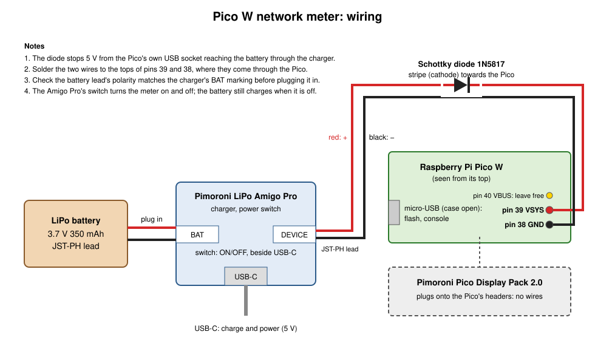
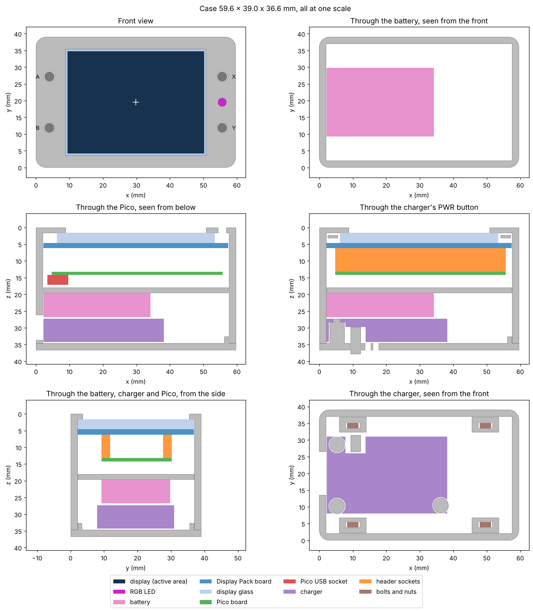

# Case, wiring and parts

A battery-powered build of the meter in a 3D-printed case:

- [BOM.md](BOM.md): the parts to buy and print, with notes on the battery.
- [wiring.svg](wiring.svg): how the battery, charger and Pico connect.
- [case/case.py](case/case.py): generates the case as STL files, in
  [case/stl/](case/stl/).



## The case

59.6 × 39.0 × 36.6 mm: 4.4 mm bigger than the Display Pack each way. The
display sits in the middle of its board, so it's in the middle of the
front too.

A 350 mAh battery and the charger are stacked behind the Pico. From the
front: the Display Pack, the Pico, a printed shelf, the battery, then the
charger, top towards the back. It's three printed parts, held together by
four M2 bolts and nuts, plus four button caps and a plunger for the charger's
PWR button.



- **Front shell** (`front.stl`):
  - the bezel, with a window onto the display's active area, and holes for
    the button caps and the RGB LED
  - walls that hug the Display Pack, square inside, and a rib that locates
    its A/B end
  - the charger's USB-C opening in the left wall
  - clearance holes for four M2 bolts through the long walls
- **Shelf** (`shelf.stl`): a plate between the Pico and the battery. Its
  four posts have pins into the Pico's mounting holes, holding it into the
  Display Pack's sockets. The battery and charger behind keep the shelf
  pressed onto the Pico. Two slots, past the charger's far end and beside
  the Pico on either side, let the power lead through.
- **Back cover** (`back.stl`):
  - three posts with pins into the charger's mounting holes: the charger
    hangs on them **top towards the back**, so its PWR button and its ON and
    CHG LEDs face out
  - a hole for the PWR button's plunger, and two small holes onto the LEDs
  - a lip along three sides that lines it up with the shell. There's none
    on the left, so the charger's USB-C end goes right against the wall
  - four blocks on its rim, beside the charger, each with a clearance hole
    for a bolt and a slot that holds an M2 hex nut and stops it turning.
    The slots open towards the front, so the nuts drop in from above with
    the cover lying on its back. `NUT_AF` and `NUT_T` set the nut's size
- **Button caps** (`buttons.stl`): four caps for A, B, X and Y, each with a
  stem through the bezel and a tab behind it, which rests on the button
  and stops the cap falling out. The fifth piece is the plunger for the
  charger's PWR button, through the back cover.

The battery lies in front of the charger, against the left wall; foam tape
holds it to the back of the shelf. Past the
charger's far end there's room for the BAT and DEVICE plugs and their
leads.

The Pico's own USB socket has no opening, and the charger sits over its
BOOTSEL button. To flash new firmware or watch the serial console, take
out the four side bolts and lift off the back cover (with the charger on it), then
the shelf with the battery stuck to it.

### Check the measurements first

`case.py` takes the Display Pack's layout from Pimoroni's dimension
drawing: the board, the buttons, the LED, the glass and the active area.
The charger's are scaled from a photograph, and the other parts' sizes are
the published ones. A few things are on
neither, and are marked **MEASURE** in the script. Check these with
calipers, change the constants at the top of `case.py`, and regenerate
before printing:

| Constant | What | Default |
|---|---|---|
| `PACK_DISPLAY_H` | Front of the Display Pack's board to the front of the glass | 3.0 mm |
| `ACTIVE_X`, `ACTIVE_Y` | The display's picture (40.8 × 30.6 mm), which the bezel's window frames. Taken to be in the middle of the board: check with the display lit | 7.2–48.0, 2.0–32.6 mm |
| `PACK_SOCKET_H` | Height of the header sockets on its back | 7.0 mm |
| `BUTTON_TOP_H` | Height of a button's top above the board | 1.5 mm |
| `PICO_USB_LEFT` | Whether the Pico's USB socket is at the A/B end (left, looking at the display) or the X/Y end. This places the shelf's posts and wire slots | A/B end |
| `PICO_X`, `PICO_Y` | Where the Pico sits on the Display Pack's back | 2.5, 7.0 mm |
| `AMIGO_HOLES` | The charger's three mounting holes. Positions on the charger are measured looking at its top with the USB-C on the right: from its USB-C end, and from its bottom edge | (3.1, 2.4), (3.1, 20.8), (34.1, 20.6) mm |
| `AMIGO_HOLE_D` | Its mounting holes' size. The cover's pins are 0.3 mm thinner | 2.1 mm (from a test print) |
| `AMIGO_PWR`, `AMIGO_PWR_H` | Its PWR button, and the height of the button's top above the board | (8.6, 2.0) mm, 1.5 mm |
| `AMIGO_LEDS` | Its CHG and ON LEDs | (14.6, 2.0), (12.3, 2.0) mm |
| `AMIGO_USB_ACROSS` | The middle of its USB-C socket, from its bottom edge | 11.0 mm |
| `AMIGO_PARTS_H` | Its tallest parts (the JST sockets) above its board | 6.0 mm |

Every run checks that the parts inside (modelled as blocks) clear the case,
and prints any clash.

### Generating the files

```sh
pip install numpy manifold3d matplotlib
python3 hardware/case/case.py --preview
```

This writes `front.stl`, `shelf.stl`, `back.stl` and `buttons.stl` to
`hardware/case/stl/`. With `--preview` it also writes a picture of each
part and `sections.png`, which cuts through the assembled case with the
parts inside in colour. `--out DIR` writes them somewhere else.

### Printing

PLA or PETG, 0.2 mm layers, 3 perimeters, 15–20% infill. No supports are
needed:

- **Front shell:** face down. The window and holes print as bridges.
- **Shelf:** flat, posts up.
- **Back cover:** outside face down.
- **Button caps:** tab down. Finer layers (0.1–0.15 mm) give cleaner stems.
  Clean any stringing off the stems, so they slide freely in the bezel.

## Assembly

1. **Wire the power lead** (see [wiring.svg](wiring.svg)). Cut the JST-PH
   lead to about 80 mm.
   - Solder the Schottky diode into the red wire, its stripe (cathode)
     towards the Pico end.
   - Solder the red wire to the top of the Pico's **pin 39 (VSYS)**, where
     the pin comes through the board, and the black wire to **pin 38
     (GND)**.
   - Cover the diode and joints with heat-shrink.
   - Leave pin 40 (VBUS) alone.
2. **Plug the Pico into the Display Pack** the way the Display Pack's
   markings show. It works only one way round. Check that its USB socket
   is at the end `PICO_USB_LEFT` says before printing.
3. **Drop the button caps into their holes** in the front shell, from the
   inside, tabs along the edge.
4. **Lower the Display Pack into the shell**, glass first, until its glass
   sits against the bezel.
   Buttons A and B go at the left-hand end, the end with the USB-C
   opening.
5. **Fit the shelf**, posts first, so their pins go into the Pico's
   mounting holes. Thread the power lead out through the slot on the side
   where the Pico's pins 38 and 39 are.
6. **Stick the battery to the back of the shelf** with foam tape, against
   the left wall, its lead towards the right-hand end.
7. **Fit the charger to the back cover.**
   - Push the PWR plunger into its hole from the inside, tab inwards.
   - Hang the charger on the three posts, **its top towards the cover**,
     so that the pins go into its mounting holes, the plunger's tab rests
     on its PWR button, and its USB-C socket is at the open end.
   - Check the battery's polarity, then plug it into the charger's **BAT**
     socket, and the Pico's lead into **DEVICE**.
8. **Close the case.** Lay the cover on its back and drop an M2 nut into
   the slot in each of its four blocks. Turn the shell over onto the
   cover, so the lip goes inside the walls, and fit the four M2 × 6 mm
   bolts through the long walls into the nuts. Don't overtighten: the
   slots hold the nuts, but PLA is soft.
9. **Switch on** by pressing the PWR plunger in the back. The charger's ON
   LED shows through its hole beside it, and CHG lights while charging.

The charger's USB-C socket charges the battery, and powers the meter while
a cable is plugged in.

To flash new firmware:
1. Take out the bolts and lift off the back cover.
2. Unplug the Pico's lead from DEVICE and lift out the shelf.
3. Hold the Pico's BOOTSEL button while plugging in its micro-USB cable.
