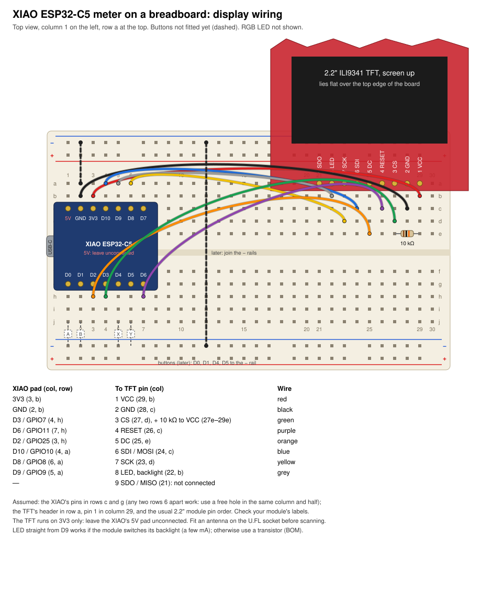

# XIAO ESP32-C5: wiring, power and parts

The meter on a Seeed Studio XIAO ESP32-C5, with a 2.2" ILI9341 SPI TFT,
four push buttons and an RGB LED, wired by hand. **Not yet built**: this is
the wiring the firmware expects (`app/boards/xiao_esp32c5_esp32c5_hpcore.overlay`),
worked out in the [port study](../../docs/port-esp32c5.md), sections 1 and 7.

- [BOM.md](BOM.md): the parts to buy, the antenna among them.
- [breadboard.svg](breadboard.svg): the display wired up on a breadboard
  (below).
- [vendor/](vendor/README.md): Seeed's schematic, KiCad project and pinout
  sheet, which the pin choices and power notes below come from.

There's no case for it yet. The Pico's case generator
([../pico/case/case.py](../pico/case/case.py)) is parametric, and a second
layout for the XIAO is planned (port study, section 7, "The case
generator").

## Wiring

Everything runs from the XIAO's **3V3** pad, so it keeps working on
battery. The TFT needs only 3.3 V.

| XIAO pad (GPIO) | To | Notes |
|---|---|---|
| 3V3 | TFT VCC, RGB LED common anode, CS pull-up | |
| GND | TFT GND, all button commons, LED switch | |
| D8 (8) | TFT SCK | SPI2 clock, through the GPIO matrix |
| D10 (10) | TFT SDI (MOSI) | SPI2 data |
| D3 (7) | TFT CS, plus 10 kΩ to 3V3 | A strapping pin with no internal pull: the pull-up fixes its level at reset and keeps the panel deselected while the chip boots |
| D2 (25) | TFT DC / RS | A strapping pin, but only for SDIO, which isn't used; an input on the TFT |
| D6 (11) | TFT RESET | UART0 TX by default: disabled in the overlay. The board's 499 Ω series resistor (R15) is harmless for a reset line |
| D9 (9) | TFT LED (backlight) | Directly if the module switches it (a few mA), else through an N-MOSFET (2N7000, BSS138) or an NPN and 1 kΩ |
| D0 (1) | Button A, other side to GND | |
| D1 (0) | Button B, other side to GND | |
| D4 (23) | Button X, other side to GND | I2C0 SDA by default: disabled in the overlay |
| D5 (24) | Button Y, other side to GND | I2C0 SCL by default: disabled in the overlay |
| D7 (12) | RGB LED red cathode, through 330 Ω | LEDC channel 0 |
| MTCK back pad, TP5 (4) | RGB LED green cathode, through 680 Ω | LEDC channel 1 |
| MTDO back pad, TP4 (5) | RGB LED blue cathode, through 680 Ω | LEDC channel 2 |
| — | TFT SDO (MISO), the module's SD card pins | Not connected: the panel is only written to |

### On a breadboard

The XIAO in columns 1–7, its USB-C at the column 1 end and its pins in
rows c and g; the TFT's header in row a, pin 1 (VCC) in column 29 and
pin 9 (SDO) in column 21, the module lying flat, screen up, over the top
edge of the board. The 10 kΩ pull-up sits between the CS and VCC columns
(27 and 29, row e). The buttons, dashed, go in later: each from its pad's
column (row j) to the bottom − rail, with the − rails joined to the
XIAO's GND. The module's pins are 1 VCC, 2 GND, 3 CS, 4 RESET, 5 DC,
6 SDI, 7 SCK, 8 LED, 9 SDO (checked on the module).

Buttons use the chip's internal pull-ups, so they need nothing but a
switch to ground. Without the RGB LED, D7 stays free and the back pads
stay unsoldered. To keep the backlight on all the time, tie the module's
LED pin to 3V3 and free D9.

The antenna goes on the XIAO's U.FL socket. The board has no other
antenna, and the meter can't hear anything without one (BOM).

## Power and battery

The XIAO has a LiPo charger and power-path switching on the board
(Seeed's schematic, sheet 03), so it needs no separate charger:

- **Charger**: from USB to the **BAT+ / BAT− pads** on the back, at
  **200 mA**. The red charge LED blinks while charging.
- **Power path**: the board runs from USB while it is plugged in, and
  from the cell otherwise.
- **3V3**: a 1 A buck converter, which also feeds the TFT, the LED and the
  pull-ups through the 3V3 pad. The **5V** pad is USB only: nothing on
  battery.
- **Battery voltage**: a switched divider into GPIO6 (GPIO26 turns it on).
  The meter doesn't read it yet.

Use a protected 3.7 V LiPo of 350–500 mAh (200 mA charges it at no more
than about 0.6 C), soldered to the BAT pads; the XIAO has no JST socket.
A slide switch in the battery lead gives a hard off.

**Current**, from the datasheet, not yet measured: about 150–200 mA while
scanning and 100–150 mA on average, with transmit peaks near 400 mA.
A 500 mAh cell would last roughly 3–5 hours.

## Flashing and the console

The USB-C socket is the C5's own USB Serial/JTAG port: esptool flashes
through it, and the console appears as a serial port
([docs/targets/xiao-esp32c5.md](../../docs/targets/xiao-esp32c5.md)). If
esptool can't connect, hold **BOOT** while plugging the board in. The
case will need openings or plungers for the RESET and BOOT buttons and the
U.FL connector, which are at the end opposite the USB-C socket.
